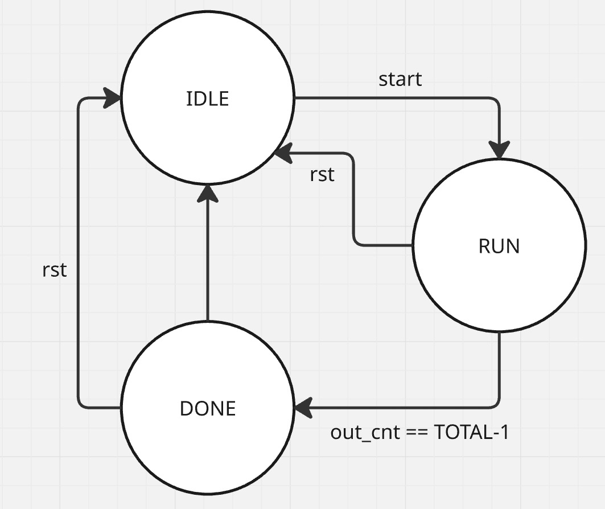
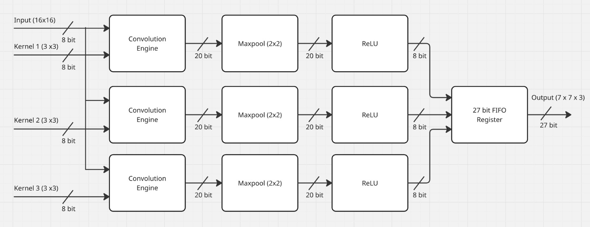
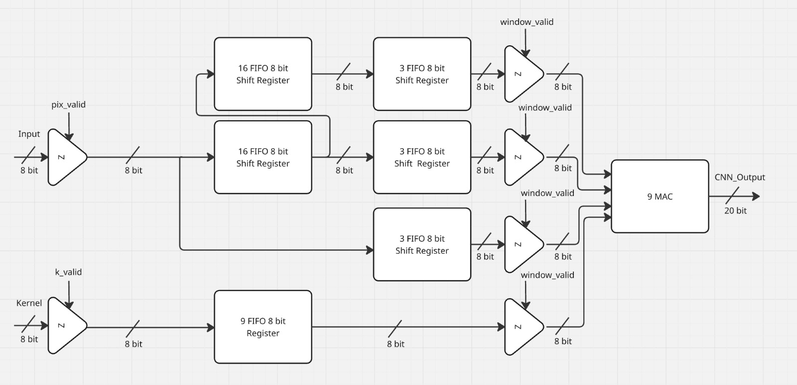
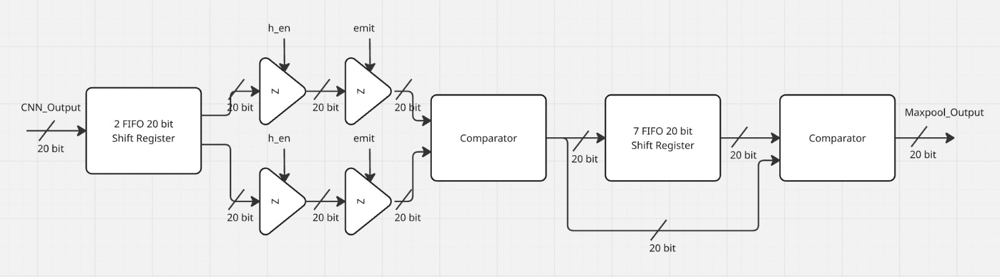
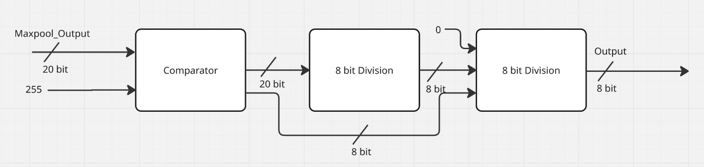

# RTL Convolution + Maxpooling + ReLU (3 Kernel 3×3)

Modul RTL (Verilog) yang menerima input 8-bit unsigned berukuran 16×16, lalu melakukan:

1. **Convolution** 3×3 dengan 3 kernel (stride 1, valid) → 14×14×3
2. **Maxpooling** 2×2 (stride 2) → 7×7×3
3. **ReLU** + kuantisasi ke 8-bit unsigned → 7×7×3

Seluruh proses berjalan secara *streaming*: satu piksel masuk per clock dan ketiga kanal diproses paralel.

---

## 1. FSM

FSM berbentuk sederhana dan terdiri dari **tiga state** (diimplementasikan pada `controller.v`):

| State | Penjelasan |
|---|---|
| `IDLE` | Menunggu sinyal `start`. Kernel dimuat sebelum `start` melalui `k_valid`/`k_data` (diatur oleh `kernel_loader`, 27 byte: kernel 1, kernel 2, kernel 3, masing-masing row-major). |
| `RUN` | Piksel dialirkan masuk, lalu dilakukan convolution, maxpooling, dan ReLU hingga seluruh 49 hasil (7×7) keluar. Pada state ini `pix_valid` diterima. |
| `DONE` | Seluruh output telah dikeluarkan. Sinyal `done` aktif satu clock, lalu kembali ke `IDLE`. |



Pada state `RUN`, controller menghitung jumlah `out_valid`. Ketika output ke-49 keluar, FSM pindah ke `DONE`. Sinyal `done` aktif satu clock setelah `out_valid` terakhir.

---

## 2. Datapath

Datapath dibagi menjadi empat bagian.

### 2.1 Top Level Datapath

Memperlihatkan input, output, dan building block yang digunakan.



Port top level `conv_pool_relu_top`:

| Port | Arah | Lebar | Keterangan |
|---|---|---|---|
| `clk`, `rst` | in | 1 | Clock dan reset sinkron |
| `k_valid`, `k_data` | in | 1, 8 | Pemuatan kernel: 27 byte, kernel 1 lebih dulu, row-major |
| `start` | in | 1 | Pulsa untuk memulai, diberikan setelah kernel dimuat |
| `pix_valid`, `pix_data` | in | 1, 8 | Aliran piksel, row-major, satu piksel per clock |
| `out_valid` | out | 1 | Satu posisi hasil pooling untuk ketiga kanal |
| `out_data` | out | 24 | `{ch3, ch2, ch1}`, masing-masing 8 bit unsigned |
| `done` | out | 1 | Aktif setelah output terakhir |

Parameter:

| Parameter | Default | Keterangan |
|---|---|---|
| `N` | 16 | Ukuran citra. Ukuran conv (`N-2`) dan pooling (`(N-2)/2`) diturunkan dari `N`. Kernel tetap 3×3. |
| `SHIFT` | 0 | Kuantisasi keluaran: nilai dibagi `2^SHIFT` sebelum saturasi. |

### 2.2 Convolution Engine Datapath



- **Sliding window dengan line buffer.** Dua line buffer sedalam 16 menyimpan dua baris piksel sebelumnya, ditambah tiga shift register 2-tap untuk membentuk window 3×3. Seluruh citra tidak disimpan.
- **Urutan elemen window** `g = baris*3 + kolom` (baris 0 = paling lama, kolom 0 = paling lama), sama dengan indeks kernel. Operasi yang dilakukan adalah korelasi biasa tanpa membalik kernel.
- **9 multiplier paralel** (`signed_mult`) diikuti penjumlah 9 suku (`mac9`). Piksel di-zero-extend menjadi 9 bit bertanda agar perkalian unsigned × signed benar. Hasil dijumlahkan dalam **20 bit bertanda** (rentang jumlah −293.760 sampai +291.465).
- **Pipeline 2 tahap:** register setelah perkalian dan register setelah penjumlahan. Throughput 1 hasil per clock.
- **`window_valid`** aktif ketika baris dan kolom ≥ 2. Sinyal ini ditunda 2 clock (latensi MAC) menjadi `conv_valid`.
- **Front end dipakai bersama:** line buffer, window, dan counter hanya satu salinan. Yang ada tiga salinan hanya register kernel, `mac9`, pooling, dan ReLU.

### 2.3 Maxpool Datapath



Menggunakan dua komparator dan hasil parsial (*partial result*), sehingga buffer tidak perlu menyimpan seluruh 14 nilai per baris:

1. **Komparator horizontal:** membandingkan nilai conv saat ini dengan nilai sebelumnya (disimpan satu register). Hasil valid pada kolom ganjil (`h_en`).
2. **Buffer 7 entri:** menyimpan hasil horizontal satu baris. Buffer bergeser setiap `h_en`.
3. **Komparator vertikal:** pada baris ganjil, hasil horizontal dibandingkan dengan isi buffer (baris di atasnya). Hasilnya valid ketika kolom dan baris sama-sama ganjil (`emit`), sehingga stride 2 dicapai lewat paritas, tanpa mux.

Semua kontrol didasarkan pada `conv_valid`, sehingga jeda 2 clock di akhir setiap baris conv tidak mengganggu.

### 2.4 ReLU Datapath



`relu_sat` memakai komparator untuk menghasilkan keluaran 8-bit unsigned terkuantisasi, dengan urutan:

1. `din < 0` → keluaran 0 (fungsi ReLU).
2. `scaled = din >>> SHIFT` → pembagian dengan `2^SHIFT` (**kuantisasi**).
3. `scaled > 255` → keluaran 255 (saturasi).
4. Selain itu → keluaran `scaled[7:0]`.

Dengan `SHIFT = 0` hanya terjadi ReLU dan saturasi. Pada data uji (`golden_custom.py`) dipakai `SHIFT = 8`, karena nilai maksimum hasil pooling 58.472 menjadi 228 setelah dibagi 256 dan masih muat dalam 8 bit.

### 2.5 Pendekatan Desain

- **Optimisasi area.** Register dihemat dengan line buffer pada input convolution dan pada input maxpool: tidak seluruh data disimpan, hanya yang dibutuhkan untuk window yang sedang bergeser. Maxpool memakai hasil parsial (horizontal lebih dulu), sehingga buffer cukup 7 entri.
- **Throughput maksimum.** MAC dibuat pipeline dengan 9 perkalian paralel, sehingga satu hasil conv keluar tiap clock. Total waktu sekitar 256 clock untuk aliran piksel ditambah sekitar 4 clock latensi pipeline.

---

## 3. Daftar Modul RTL

| Modul Verilog | Deskripsi |
|---|---|
| `controller.v` | FSM tiga state (IDLE, RUN, DONE); menghitung `out_valid` dan menghasilkan `run` serta `done`. |
| `conv_pool_relu_top.v` | Top level yang menggabungkan seluruh building block; menyusun rantai valid (`window_valid` → `conv_valid` → `out_valid`). |
| `conv_ctrl.v` | Counter baris/kolom piksel masuk; menghasilkan `window_valid` untuk window 3×3 yang valid. |
| `kernel_loader.v` | Menerima 27 byte kernel dan menyimpannya ke register; dipakai tiap kanal 9 byte. |
| `mac9.v` | 9 perkalian paralel (pipeline) dan penjumlahan 9 suku menjadi hasil conv 20 bit. |
| `signed_mult.v` | Perkalian piksel unsigned dengan kernel signed (piksel di-zero-extend 1 bit). |
| `pool_ctrl.v` | Counter baris/kolom keluaran conv; menghasilkan `h_en` (pasangan horizontal selesai) dan `emit` (blok 2×2 selesai). |
| `pool_relu_ch.v` | Satu kanal maxpool (horizontal lalu vertikal, buffer 7 entri) dan ReLU. |
| `relu_sat.v` | Komparator untuk ReLU, kuantisasi (`SHIFT`), dan saturasi ke 8 bit. |
| `shift_reg.v` | Shift register ber-enable, dipakai untuk line buffer, window, dan buffer pooling. |
| `window_frontend.v` | Dua line buffer dan tiga baris window; menghasilkan 9 piksel paralel yang dipakai bersama oleh ketiga kanal. |

---

## 4. Golden Model dan Testbench

| File | Deskripsi |
|---|---|
| `golden.py` | Golden model Python (conv → maxpool → ReLU/saturasi) dengan data acak atau kasus khusus. Menulis `image.hex`, `kernel.hex`, `expected.hex`. |
| `tb_top.v` | Testbench umum; membaca file `.hex`, mengalirkan citra, dan membandingkan setiap output dengan `expected.hex`. Memiliki parameter `SHIFT`. |
| `golden_custom.py` | Golden model untuk citra dan tiga kernel yang diberikan pada tugas. Mencetak hasil tiap tahap (conv, maxpool, ReLU) dan membuat `tb_custom.v`. `SHIFT` diatur di bagian atas file. |
| `tb_custom.v` | Testbench terarah (dibuat otomatis) dengan data tertanam; mencetak grid 7×7 hasil DUT di samping hasil yang diharapkan, lalu `PASS` atau `FAIL`. |
| `golden_custom_output.txt` | Keluaran lengkap `golden_custom.py`: hasil conv, maxpool, dan ReLU untuk tiap kanal. |

### Mode uji `golden.py`

| Mode | Tujuan |
|---|---|
| `random` | Piksel dan kernel acak penuh (banyak keluaran tersaturasi) |
| `mid` | Nilai kecil sehingga hasil berada di dalam rentang 0–255 (tanpa saturasi) |
| `zeros` | Citra nol |
| `max_pos` | Semua piksel 255, kernel +127 (saturasi positif) |
| `max_neg` | Semua piksel 255, kernel −128 (ReLU menghasilkan 0) |
| `checker` | Pola papan catur 0/255 dengan kernel bertanda campuran |

### Cara menjalankan (Makefile)
 
Kebutuhan: Icarus Verilog (`iverilog`, `vvp`) dan Python 3. GTKWave opsional untuk melihat waveform.
 
| Perintah | Fungsi |
|---|---|
| `make help` | Menampilkan daftar target |
| `make lint` | Mengompilasi RTL saja dengan peringatan |
| `make run` | Menjalankan `tb_top` terhadap `golden.py` (opsi: `MODE`, `SEED`, `SHIFT`) |
| `make custom` | Membuat ulang `tb_custom.v` dari `golden_custom.py`, lalu menjalankannya |
| `make regress` | Seluruh mode × `SHIFT` 0, 6, 9 × 2 seed, ditambah data tugas; menampilkan `REGRESSION PASSED` bila semua lolos |
| `make wave` / `make wave-custom` | Membuka waveform terakhir di GTKWave |
| `make clean` | Menghapus folder `build/` |
 
Contoh:
 
```bash
make run MODE=mid SEED=2 SHIFT=8
make custom
make regress
```
 
`SHIFT` diteruskan ke golden model dan ke simulasi sekaligus, sehingga keduanya selalu sama. Untuk data tugas, `SHIFT` diatur langsung di bagian atas `src/testbench/golden_custom.py`.

### Hasil simulasi

Seluruh 49 keluaran (7×7) per kanal sesuai dengan golden model untuk semua mode uji pada `SHIFT` 0, 6, dan 9, serta untuk data tugas pada `SHIFT` 0, 8, dan 10 (simulator: Icarus Verilog).

---

## Asumsi dan Catatan

- Aliran piksel diasumsikan kontinu setelah `start` (satu piksel per clock, tanpa jeda).
- Kernel dimuat sebelum `start`.
- Ukuran kernel tetap 3×3 (`mac9` bersifat tetap); `N` dapat diubah melalui parameter.
- Register data tidak di-reset, sehingga nilai `X` dapat muncul pada siklus ketika `out_valid = 0`. Testbench hanya memeriksa saat `out_valid = 1`.
- Spesifikasi tidak menjelaskan cara mengubah 20 bit menjadi 8 bit. Di sini dipilih ReLU, pergeseran `SHIFT`, lalu saturasi.
- Contoh patch pada gambar spesifikasi memberikan nilai berbeda dari hasil hitung korelasi biasa (−60, 0, dan −240, dicetak oleh `golden.py`), sehingga testbench memakai golden model, bukan nilai pada gambar.